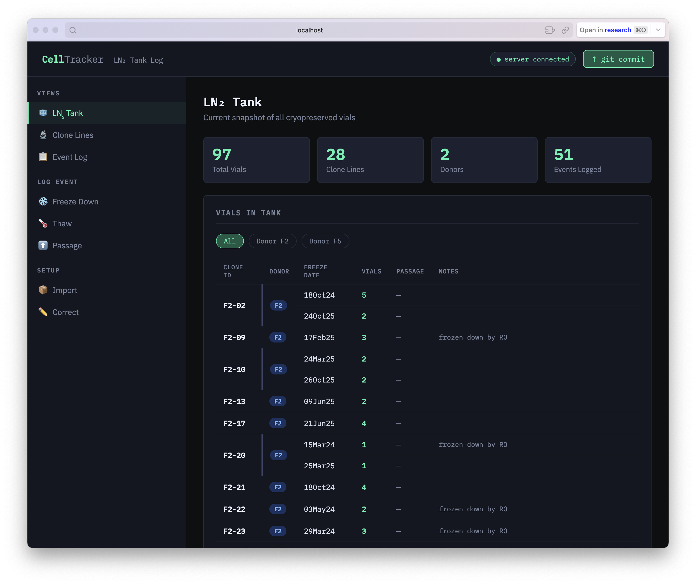
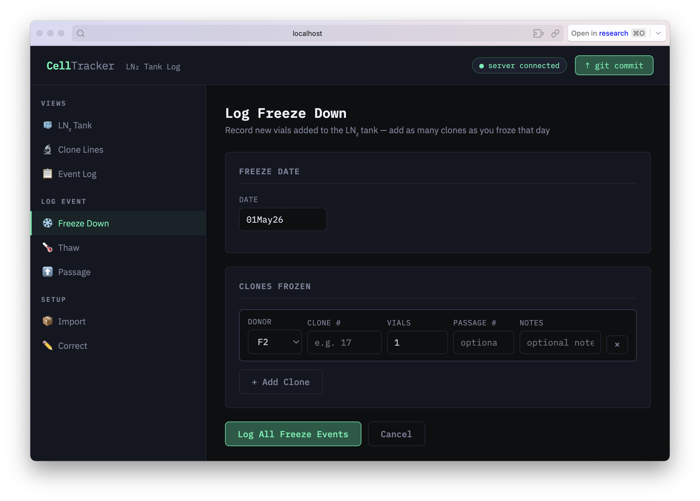
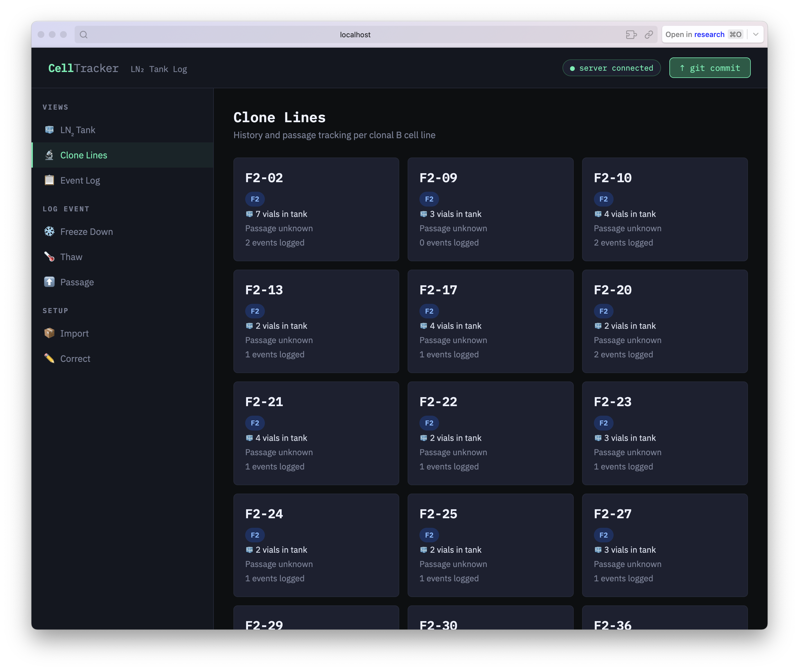
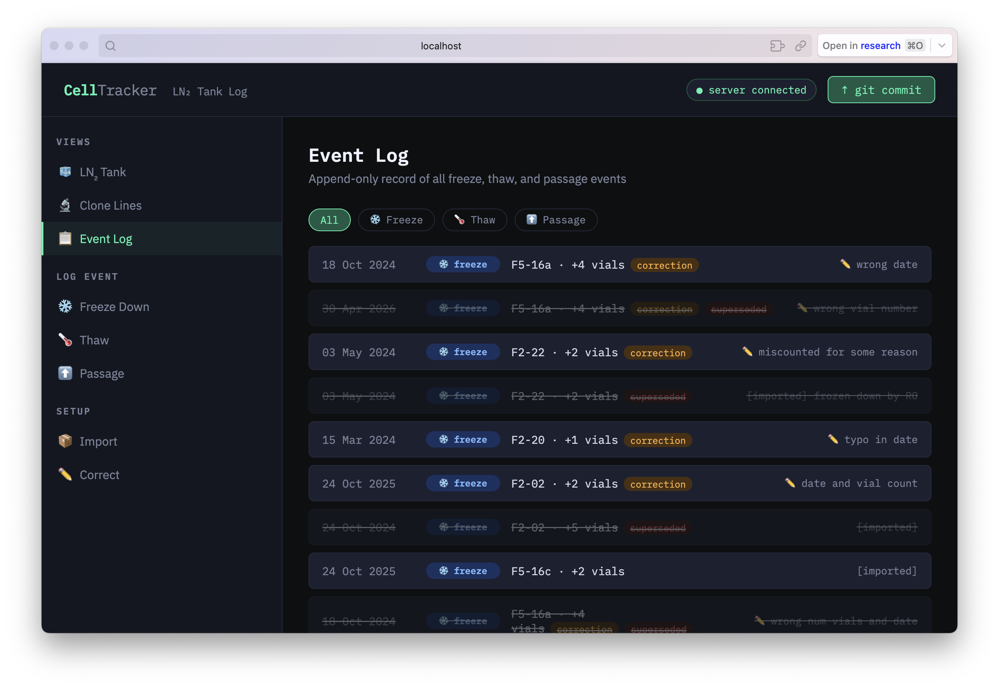

\*made with Claude Pro. shoutout to Roseann

# welcome 2 my cell bank 🧬

A local web app for tracking clonal B cell lines: LN₂ tank inventory, active cultures, passage and jassage numbers, and the full event history. All data is stored as plain JSON files in a git repo, so there is no database or hosting to set up.

## Pages

| Section | Page | Purpose |
|---|---|---|
| View | 🧊 **LN₂ Tank** | Current vial inventory, grouped by clone. Click a clone to see its detail. |
| View | 🔬 **Clone Lines** | Card per clone; detail overlay with batches, event history (newest first), and batch editing. |
| View | 📋 **Event Log** | Chronological log of all events, with edit/delete (confirmation required). |
| Log Event | 🌡️ **Thaw** | Log vials removed from the tank. Starts an active culture. |
| Log Event | ⬆️ **Passage** | Passage clones currently in culture (checkbox selection, optional notes). |
| Log Event | ❄️ **Freeze** (End Culture) | Freeze down or discard cultures (checkbox selection, larger notes box). |
| Setup | 📦 **Import Vials** | Bulk-enter existing inventory, including initial (unexpanded) vials. |
| Setup | ✏️ **Correct Manually** | Fix a batch's count, passage, jassage, location, notes, or date. Logs a correction event. |
| Setup | 🧭 **Infer Passages** | Reconstruct past culture history from lab notebook entries. |

After logging a Passage or End Culture, the app stays on that page so you can keep entering.

## Workflow

1. **First time:** use **Import Vials** to enter your current inventory.
2. **Every thaw:** use **Thaw**. The clone now has an active culture.
3. **Every passage:** use **Passage**, selecting the cultures you passed (only clones in culture are listed).
4. **End of a culture:** use **Freeze** (End Culture) to freeze down (enter vials frozen) or discard.
5. **Made a mistake?** Edit or delete the event in the Event Log, or use **Correct Manually** / the edit button in the clone overlay. The original is preserved.
6. **After any session:** click **↑ git commit** (top right) to snapshot everything.

## Passage and jassage

- **Jassage** counts passages since the J0 baseline (**07 May 2026**). Absolute passage = `pre_jassage + jassage`; while `pre_jassage` is unknown it displays as `P(…+N)`.
- Rules: passage **+1**, freeze **+1**, thaw **0**.
- Frozen vials in the tank are never changed by passage events. A freeze batch gets its jassage only when its culture is ended with a freeze.
- Batches without a jassage default to **J0**.
- Jassage badges are colored: J0 blue, J1 green, J2 amber, J3 purple, J4 teal, J5+ grey.
- The event log shows the jassage change for each passage (e.g. `J1 → J2`).

## Active cultures

Each thawed vial creates one active culture (two vials thawed on the same day are two cultures). For a given clone, each freeze or discard closes the **oldest** open culture (FIFO). A culture starts at the jassage of the vial that was thawed. Flask tracking was dropped; cultures are tracked per clone.

## Batch fields

Each vial batch stores: `clone_key`, `donor`, `clone_num`, `freeze_date`, `count`, `passage`, `jassage`, `pre_jassage`, `parent_freeze_date` (the batch it was thawed from), `location`, and `notes`.

- **Location** uses `rack.box`: rack 4, box 2 is `4.2`.
- **Parent batch** is recorded automatically when a culture is frozen, and backfilled for older batches.
- **Initial vials** (original unexpanded vials) have a freeze date of `-`, displayed as `—`.

## Events

Types: `freeze`, `thaw`, `passage`, `discard`, `bulk_import`, and corrections. A bulk import is one event listing all imported clones. Editing an event keeps the original, marked superseded and linked to its replacement. The log has a toggle to show/hide superseded entries; corrections show by default.

## Infer Passages

For reconstructing history from a notebook, organized by date:

- Enter thaws, passages, freezes (with editable frozen counts), and discards per day.
- Thaw entries have **ghost?** and **initial thaw?** checkboxes.
- Logged days list their entries, each with a × delete button.
- Lineage trees are hidden until you pick a donor and/or clone in the dropdowns.
- Ambiguous cases (e.g. which batch was thawed) are flagged for you to resolve; **Apply All** commits the results.
- Inference thaws do **not** change the main LN₂ tank. Working state is saved to `data/inference.json`.

## Setup (one time)

```bash
# 1. Put the celltracker folder somewhere permanent
cd ~/celltracker

# 2. Initialize git repo
git init
git add .
git commit -m "Initial CellTracker setup"

# 3. Optionally push to a private GitHub repo:
gh repo create celltracker --private --source=. --push
# or via SSH:
git remote add origin git@github.com:YOURUSER/celltracker.git
git push -u origin main
```

## Working with contributors

The cell bank lives in one GitHub repo. A contributor who thaws and freezes cells works on a branch and opens a pull request, and the owner reviews and merges it.

**Owner, one time:** push the repo to GitHub (see Setup above) and add each contributor under Settings → Collaborators.

**Contributor, each session:**

```bash
git checkout main && git pull       # start from the latest cell bank
git checkout -b thaw-F2-09-nov14    # one branch per session
python3 server.py                   # log thaws, passages, and freezes in the app
```

When finished, click **↑ git commit** in the app, which commits to your branch locally. Then send it for review:

```bash
git push -u origin thaw-F2-09-nov14
gh pr create --fill                 # or open the pull request on github.com
```

**Owner, reviewing:** the diff on `data/events.json` shows which events were added, and `data/vials.json` shows the resulting tank changes. Merge the pull request if it matches what the contributor did, then run `git checkout main && git pull` to update your own copy.

**Keeping things in sync:** everyone should pull `main` before logging anything. If you both log events at the same time, the two branches may conflict at the end of `events.json`. Git will flag it when you merge, and the fix is to keep both sets of events.

## Running

```bash
cd ~/celltracker
python3 server.py
# Then open http://localhost:8787 in your browser
```

Nothing needs to be installed beyond Python 3. The app is a single `index.html` served by `server.py` (standard library only), which also exposes `/api/save` (writes JSON in `data/`) and `/api/commit` (`git add -A` + `git commit`).

## Date format

Dates display as `'YYMMMdd`, e.g. `'26Sep11` = September 11th, 2026 (apostrophe, 2-digit year, 3-letter month, 2-digit day). The leading apostrophe is required when typing a date; input without it is rejected. Internally everything is stored as ISO `YYYY-MM-DD`.

## Data files

- `data/vials.json` — current LN₂ tank state (what's physically in the tank right now)
- `data/events.json` — event log
- `data/inference.json` — Infer Passages working state (`reconDays`, `ambiguityResolutions`)
- `data/flasks.json` — legacy; flask tracking is no longer used

On every load the app normalizes state: clone keys, superseded links, missing vials rebuilt from freeze events, duplicates removed, corrections applied, thaw decrements re-applied, jassage defaults, parent-batch backfill, and date repair.

## Git history = version control

Every commit is a complete snapshot. Useful commands:

```bash
git log --oneline                      # all snapshots
git show HEAD:data/vials.json          # tank state at latest commit
git diff HEAD~1 data/events.json       # what changed since last commit
git show <hash>:data/vials.json        # tank state at any point in time
```

## Bulk import via JSON

Paste into **Import Vials → Bulk JSON Import**:

```json
[
  {"donor": "F5", "clone": "17", "freeze_date": "2025-04-23", "count": 3, "passage": 4, "location": "4.2", "notes": "from old lab member"},
  {"donor": "F2", "clone": "3",  "freeze_date": "initial", "count": 2}
]
```

- `freeze_date`: `'YYMMMdd` (e.g. `'26Sep11`), ISO `YYYY-MM-DD`, or `"initial"` for an unexpanded initial vial (stored as `-`). Any other value cancels the import with an error.
- Optional: `passage`, `location`, `notes`.
- The whole import is recorded as one `bulk_import` event.

## How It Looks

### LN₂ Tank
The tank page shows all vials currently in the LN₂. Clones with multiple freeze batches are grouped together — clone ID and donor appear once on the left spanning all rows, with each batch on its own line showing freeze date, vial count, passage, jassage badge, location, and notes. Filter by donor, passage, or jassage. Click any clone ID to open a detail popup with full batch breakdown and event history.


### Freeze
Select the cultures to end, then freeze down (with the number of vials frozen) or discard. Dates use the `'26Sep11` format.


### Clone Lines
Card view of every clone line. Shows total vials in tank, current passage/jassage, and event count. Click any card for the full detail popup.


### Event Log
Chronological log of every freeze, thaw, passage, discard, bulk import, and correction event. Filterable by type. Superseded entries are hidden by default and can be toggled on; corrections show with an amber badge and reason.

